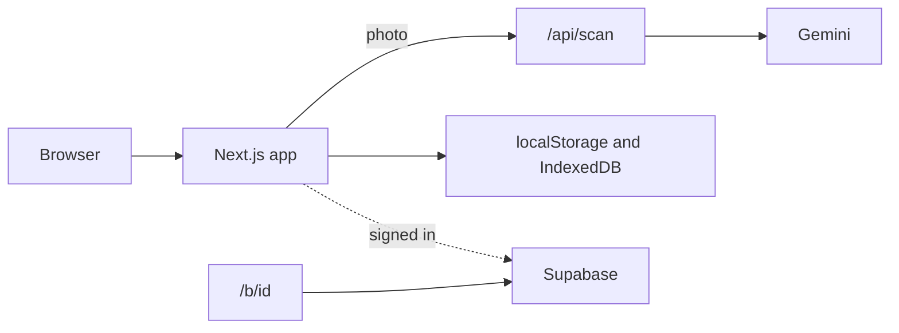

# WeSplit

Singapore bill splitter: scan a receipt, tap who had what, settle with PayNow. Live at [wesplit-sg.vercel.app](https://wesplit-sg.vercel.app).

## Features

- Scan a receipt photo with Gemini, or type the items in. Charge modes are 10% service + 9% GST, GST only, service only, or none. When the printed total matches one of those, that mode is selected.
- Item discounts, 1-for-1 items, bill-level discounts, and an extra percentage or dollar voucher. Service charge and GST are calculated after discounts.
- Assign each item by tapping people. Portions can be uneven (for example 2:1). Shares are rounded to the cent and add up to the total.
- A PayNow QR per person, with the amount and a reference. Send it on WhatsApp or Telegram, through the share sheet, or as a saved image.
- A public link (`/b/[id]`) shows each person's amount and QR, follows paid status, and can be revoked. Receipt photos stay on the owner's device and in private storage.
- Bill history with place and optional location, a friends list with balances, and one PayNow nudge that covers several bills.
- Optional sign-in with Google or an email magic link. Bills, friends, PayNow details, and receipt photos then sync. Until you sign in, they stay on the device.
- Installable PWA. Entering items works offline. Light and dark theme.

## Stack

- Next.js 16 (App Router), React 19, TypeScript, Node.js 22
- Vercel AI SDK (`ai`, `@ai-sdk/google`) calling Gemini
- Supabase Auth, Postgres, and Storage (`@supabase/supabase-js`, `@supabase/ssr`)
- Zod for the scan schema, `qrcode` for PayNow QRs
- Deployed on Vercel

The split math and PayNow payload live in `lib/split.mjs`. `npm test` runs the unit tests there.

## Architecture

The UI is one client page. Bills are written to the device first. A scan posts the photo to a route handler, which asks Gemini for structured line items and then discards the image. Accounts, sync, and public links go through Supabase when those environment variables are set.



`/api/scan` checks the request origin, a short proof of work, and per-IP limits, then returns the merchant, items, discounts, and totals. PayNow QRs are built in the browser (EMVCo SGQR). Signed-in users sync bills, friends, and the PayNow profile to Postgres, and a compressed receipt photo to a private Storage bucket. Creating a share link stores a snapshot through a Supabase function; `/b/[id]` reads that snapshot.

## Run locally

Node.js 22.

```bash
npm install
npm run dev
```

Open http://localhost:3000.

```bash
npm test
npm run build
npm start
```

## Environment

Names only. Put them in `.env.local`, which is gitignored. Scanning and splitting need the Gemini key. Accounts, sync, and share links need both Supabase variables.

| Name | Role |
| --- | --- |
| `GOOGLE_GENERATIVE_AI_API_KEY` | Gemini API key. Required to scan. Read by `@ai-sdk/google`. |
| `ASK_MODEL` | Optional model id. Defaults to `gemini-3.5-flash-lite`. |
| `NEXT_PUBLIC_SUPABASE_URL` | Supabase project URL. Accounts, sync, and share links. |
| `NEXT_PUBLIC_SUPABASE_ANON_KEY` | Supabase publishable key. Same features as the URL. |

## License

[MIT](LICENSE) © 2026 Josh Lim
